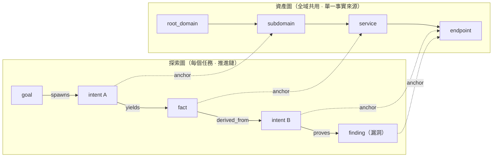
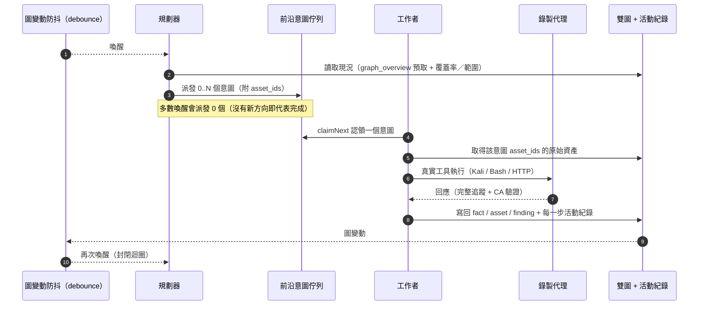
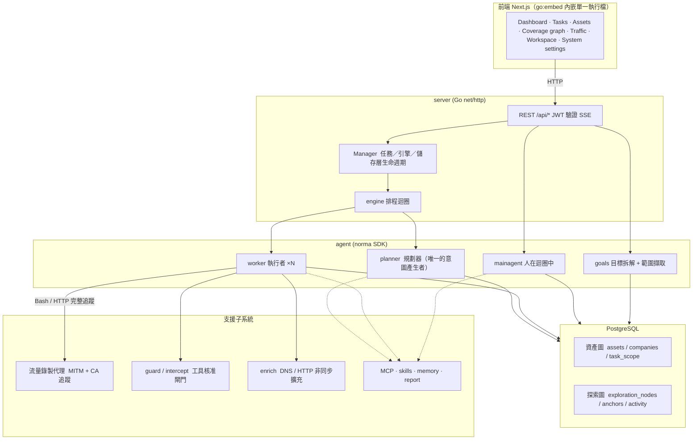

<div align="center">

**[English](README.md)** | **繁體中文**


# ARTEX

**會保留所有憑據的自主式滲透測試。**

（上游專案：[Autumn-27/ARTEX](https://github.com/Autumn-27)，AGPL-3.0）

自行託管的多代理（multi-agent）攻擊性資安平台。規劃器負責探索、工作者（worker）執行真實工具，
而每一項發現（finding）都與證明它的資產及 HTTP 流量綁定在一起。

[](https://github.com/BaaRai/ARTEX/releases)
[](LICENSE)
[](https://github.com/BaaRai/ARTEX/actions/workflows/ci.yml)
[](go.mod)

[快速開始](#快速開始) · [截圖](#截圖) · [運作原理](#運作原理) · [安裝](#安裝) · [設定](#設定) · [安全性](SECURITY.md)

</div>

---

ARTEX 是自行託管、由 LLM 驅動的滲透測試平台。它不是掃描器外面套一層聊天介面：規劃器（planner）
把目標拆解為多個意圖（intent），工作者（worker）以真實工具執行這些意圖，結果則寫回**兩張互相連結的圖**：
一張記錄你對目標已知的資訊，另一張記錄測試的進展。每一項發現都可以附上證明它的原始請求與回應，
而每一個自主動作都必須通過範圍（scope）規則、核准閘門與預算限制。

- **它是在探索，不是在聊天。** 目標拆解、意圖派發、工作者執行與寫回，形成一個封閉迴圈，
  持續推進直到目標被證明為止。
- **兩張圖，一條稽核軌跡。** 共用的資產圖說明*有什麼存在*；每個任務專屬的探索圖說明
  *嘗試過什麼、產出了什麼、為什麼這麼做*。錨點（anchor）把兩者連結起來。
- **有證據的發現。** 錄製式 MITM 代理與瀏覽器擴充功能擷取真實流量；發現、證據引文與重測
  都綁定到確切的請求／回應。
- **有煞車的自主性。** 人在迴圈中的核准、argv 前綴規則、範圍／拒絕閘門、token 與回合預算、
  目標雜訊調節器，以及對工具輸出的提示注入（prompt injection）防護框架。
- **自行託管、模型無關。** 單一 Go 執行檔內嵌 Next.js UI，搭配 PostgreSQL，
  可使用你自己的 Anthropic／OpenAI 相容端點，或本機 Ollama。

---

## 快速開始

```bash
git clone https://github.com/BaaRai/ARTEX.git
cd ARTEX
cp .env.example .env            # set POSTGRES_PASSWORD (and optionally an LLM key)
docker compose up -d --build    # builds from this checkout, starts PostgreSQL
```

開啟 **http://localhost:8787**。首次造訪時，`/setup` 會要求輸入啟動時印出的一次性設定權杖（setup token）：

```bash
docker compose logs artex | grep "Setup token"
```

> 沒有可直接拉取的預建 Docker 映像檔：映像檔一律從你的本機原始碼建置。
> 所有安裝方式（腳本、執行檔、原始碼、發行封存檔）請見[安裝](#安裝)。

---

## 多供應商 Worker

在 **System → LLM** 中設定你要使用的設定檔（profile）。在 **System → Settings** 中，
開始任務前請將並行 worker 數量設為至少 **2**（此數量會套用於之後啟動的任務）。
在 **System → Agents → Worker** 中，請讓模型維持跟隨任務；若固定了 Worker 模型，
其優先權高於輪替。

建立任務時，在 **LLM config chain** 中選取兩個設定檔、排列其順序，並啟用
**Enable multi-LLM worker rotation**。對於既有任務，開啟其 LLM 設定控制項，
變更開關或設定檔順序後儲存即可。

輪替會依序將 worker 意圖指派給 A、B、A、B，與完成順序無關。不同的意圖可以在不同供應商上並行執行；
每個意圖會固定使用其被選定的供應商，除非發生容錯移轉（failover）。規劃器與其他未綁定的角色
則繼續使用任務目前的設定檔。關閉輪替後，會恢復為依序進行的任務層級容錯移轉。被排除的供應商會被跳過，
因此固定在已耗盡設定檔上的意圖會退回使用任務目前的設定檔，而不是重試該設定檔；
輪替會持續循環整份清單，不會繞過已失效的供應商重新平衡。儲存設定鏈會重設它們的失敗狀態。
變更不會中斷進行中的呼叫。輪替游標在伺服器重啟後會重新開始，儲存設定鏈也不會重設它；
設定檔順序與開關則會持久保存。

建立任務與 `PUT /api/tasks/{id}/llm` 這兩個 API 皆接受 `llm_rotate: true`，
並搭配有序的 `llm_profile_ids`。更新時若省略 `llm_rotate`，則保留其原值。

## 截圖

| 任務 | 發現 |
| :---: | :---: |
|  |  |

| 任務執行：工作階段與工具呼叫 | 探索圖 |
| :---: | :---: |
|  |  |

| 資產覆蓋圖 | 流量錄製 |
| :---: | :---: |
|  |  |

| 人在迴圈中的對話 | 攔截核准 |
| :---: | :---: |
|  |  |

<details>
<summary>更多截圖（資產、代理、LLM、日誌）</summary>

| 資產 | 代理管理 |
| :---: | :---: |
|  |  |

| LLM 設定 | 後端日誌 |
| :---: | :---: |
|  |  |

</details>

---

## 運作原理

### 雙圖架構：探索圖 + 資產圖

ARTEX 把*目標是什麼*與*測試進展到哪裡*分開，成為兩張獨立的圖，再以錨點連結：

- **資產圖（跨任務共用）。** `root_domain / subdomain / ip / service / app / endpoint`
  的單一事實來源，歸屬於公司（company）。父子關係與去重鍵由程式計算；代理只負責提交原始觀察結果。
- **探索圖（每個任務一張）。** 任務的推理與進展：`goal / intent / fact / finding / hint`
  節點，透過 `spawns / derived_from / yields / proves` 邊串成譜系鏈（lineage chain）。
- **錨點連結兩者。** `exploration_anchors(node_id, asset_id)` 把意圖、事實與發現綁定到具體資產：
  某個方向觸及了哪些資產，以及哪些意圖測試過某個資產。這也支撐了**資產測試覆蓋率**與覆蓋圖。



**規劃器（planner）**讀取探索圖、判斷目標，且只有在存在尚未涵蓋的方向時才派發意圖；
**工作者（worker）**認領一個意圖、執行它，把資產／事實／發現寫回兩張圖，然後停止。

### 引擎迴圈

引擎是事件驅動的：任何圖的變動都會喚醒規劃器，工作者認領並執行意圖，
寫回後觸發下一輪，直到 `prove_goal` 結束任務。



### 持久的攻擊鏈、共享的 worker 記憶

真實的攻擊鏈是多步驟且有順序的（找到注入點 → 取得憑證 → 橫向移動）。規劃器維護一份
**跨喚醒、依任務保留的待辦清單（todolist）**：它只記錄一次攻擊鏈，之後只有在前置條件
被事實滿足時，才派發下一步。

Worker 也可以**搜尋彼此的執行軌跡**（`search_all_worker_traces`、`list_worker_traces`、
`get_worker_trace`）。從未成為正式事實的觀察（一則錯誤訊息、一段回應片段、一個隱藏參數）
仍然可供下一個 worker 重複利用，同時每個 worker 仍被限制在它所認領的意圖之內。

---

## 功能

### 要證據，不要聊天紀錄

- **錄製式 MITM 代理**（`:8788`）搭配自動產生的 CA：每一次 Bash／HTTP 工具呼叫都會被追蹤，
  請求／回應證據可以綁定到某項發現。
- **瀏覽器擴充功能**（`extension/`）適用於需要驗證的目標：登入一次（包含驗證碼、Email OTP、
  雙因素驗證），擷取工作階段，其請求／回應就會進入同一個流量儲存庫。

  <details>
  <summary>使用流量擷取擴充功能</summary>

  - 從 `extension/` 載入未封裝的擴充功能（Chrome/Edge：開啟開發人員模式 → 載入未封裝項目）；
  - 在彈出視窗中設定你的 ARTEX URL 與權杖，然後在你正在瀏覽的分頁按下 **Start capture**；
  - 照常使用該網站；文字型的請求／回應會分批送到 `POST /api/traffic/ingest`
    （需驗證）。二進位內容（圖片、字型）會被略過，內容超過 256 KiB 會被截斷，
    每批最多 50 筆；
  - 完成後按下 **Stop**。所有內容都保留在你本機的流量儲存庫中。

  </details>
- **已驗證的發現**：發現帶有 POE 等級、驗證狀態與備註；只有在有綁定的證明／回應，
  且逐字證據引文支持時，發現才會被標為 `verified`。進行引文檢查之前，會先解碼 gzip/deflate 內容。
- **漏洞重測迴圈**：專屬的 `retester` 代理會以選用的固定版本／條件重新執行某項發現，
  記錄 `Still reproducible / Fixed / Cannot confirm`（仍可重現／已修復／無法確認），
  並可自動把該發現移至 `Fixed`。原始證據與報告都會保留。
- **報告與匯出**：發現、證據與任務封存檔；流量快照以靜態加密（encrypted at rest）方式保存。

### 控管，但不拖慢速度

- **攔截閘門**：每一次工具呼叫都可以要求人工核准，規則可依 `string`、`regex` 或
  **argv 前綴**設定。argv 規則是一個含 1 到 8 個 token 的 JSON 陣列（僅限 Bash，
  例如 `["git","push"]`）；它只會比對單一簡單指令，且其解析後的前綴必須與該模式完全相同。
  管線、串列、重新導向、前綴賦值、子 shell、背景工作、包裝程式，以及指令／參數替換都不會匹配；
  旗標在設計上會被忽略（`["git","push"]` 涵蓋 `git push --force`，但 `git -C /repo push`
  則什麼都不匹配）。每次核准都會記錄決定者：`human`、`rule`、`model` 或 `system`。
- **範圍與目標閘門**：範圍列定義覆蓋率的分母；宣告範圍之外的資產不會被探索。
  目標閘門（預設關閉，僅限 API）可以拒絕未經核准的目的地。
- **預算**：`ARTEX_TASK_BUDGET_TOKENS` / `ARTEX_TASK_BUDGET_TURNS` 限制整個任務
  （規劃器與 worker）；`ARTEX_INTENT_BUDGET_TOKENS` / `ARTEX_INTENT_BUDGET_TURNS`
  限制單次 worker 執行。接近上限時，任務會進入強制收尾；若剩餘預算不足以支應一個 worker，
  就不會啟動它。預算存放在記憶體中：重啟後會重新開始。
- **雜訊調節器**：`ARTEX_NOISE_PROFILE=quiet|balanced|aggressive` 控制 ARTEX 對目標發送請求的節奏
  （每個主機的速率、突發量、同時進行數上限、抖動、遇到 429/503 時退避、短時間 GET 快取）。
  設定了設定檔後，代理也會收到針對已安裝掃描器的低速慢掃（low-and-slow）旗標。
- **不受信任輸出邊界（預設開啟）**：工具結果會被包在帶有隨機標記（nonce）的標記之間，
  讓模型把它視為資料而非指令。可用 `ARTEX_UNTRUSTED_BOUNDARY=0` 停用。

### 資產與覆蓋率

- **覆蓋率帳本與力導向覆蓋圖**：範圍內的資產會標示為已測試或未測試，
  每個節點都附有相連的意圖、事實與發現。
- **公司層級的資產圖**：跨任務共用，由程式去重，具備
  domain → subdomain → service → endpoint 的包含關係。
- **ScopeSentry 同步**：依專案或任務，從
  [ScopeSentry](https://github.com/Autumn-27/ScopeSentry) 實例拉取資產資料，
  依公司範圍合併進資產圖，供代理探索。

  <details>
  <summary>從 ScopeSentry 同步</summary>

  - 在 **Asset Sync** 頁面，輸入 ScopeSentry 位址與 API 金鑰；
  - 依**專案**或**任務**選擇目標與資產類型（網域／子網域／IP／連接埠／站點／端點…）；
  - 匯入：資料列會依公司資產範圍合併，成為資產圖的一部分。

  </details>
- **任務分類、範本、關聯與封存**，適用於可重複執行的專案。

### 平台

- **具容錯移轉的 LLM 設定檔**：Anthropic、OpenAI、OpenAI 相容中繼，以及免金鑰的 Ollama；
  每個任務可設定多個設定檔，並自動容錯移轉。
- **Token 計量**：每個任務與每個工作階段的用量、快取讀取／寫入，以及針對每次呼叫的 LLM 紀錄檢視。
- **MCP 伺服器、技能（skills）、記憶與工作區**：以遠端工具與可重複使用的提示詞／作戰手冊素材擴充代理能力。
- **單一執行檔**：Next.js UI 以 `go:embed` 內嵌；PostgreSQL 是唯一的外部相依項目。

---

## 安裝

> 需要 **PostgreSQL**；探索功能需要 **LLM**（`ANTHROPIC_API_KEY` 或
> `OPENAI_API_KEY`，也可在 UI 中設定）。

### 方式一：一鍵安裝腳本（建議）

```bash
git clone https://github.com/BaaRai/ARTEX.git
cd ARTEX
./install.sh
```

腳本會偵測或安裝 Docker，然後提供 **① 全 Docker**（寫入 `.env`，執行
`docker compose up -d --build`）或 **② 本機建置並執行**（產生 `config.json`、建置內嵌執行檔、啟動它）。

開啟 **http://localhost:8787**；`/setup` 會要求輸入啟動時印出的一次性設定權杖
（`docker compose logs artex | grep "Setup token"`）。

UI 預設只監聽 `127.0.0.1`。若要從其他機器存取（或當 ARTEX 在 WSL 中執行、而你要從 Windows 存取時），
請在 `.env` 中設定 `ARTEX_BIND_ADDR=0.0.0.0`（設定權杖仍會保護首次啟用的認領程序），
或維持 loopback 並使用反向代理或 SSH 通道。

### 方式二：Docker Compose（手動）

```bash
git clone https://github.com/BaaRai/ARTEX.git
cd ARTEX
cp .env.example .env            # set POSTGRES_PASSWORD, optionally ANTHROPIC_API_KEY
docker compose up -d --build
# → http://localhost:8787
```

映像檔內含掃描器工具鏈（`nmap`、`nuclei`、`httpx`、`katana`、`ffuf`、`dalfox`、
`sqlmap`、`ripgrep`、`curl`、`npm` 等）；`./skills` 與 `./data` 透過 bind mount 持久保存。

遠端 MCP 可在系統設定中選擇 `http`（Streamable HTTP）或 `sse`（舊版 SSE）。
舊版 SSE 伺服器通常以 `GET /sse` 建立事件串流，並透過 `/message?sessionId=...` 接收 JSON-RPC；
請將 URL 設為 `/sse`，並送出 `Authorization: Bearer <token>`。

### 方式三：預建執行檔（Releases）

從 [Releases](https://github.com/BaaRai/ARTEX/releases) 下載對應平台的 zip。其中包含
`artex`、`start.sh`（Windows 為 `start.bat`）、`skills/` 與 `config.example.json`：

```bash
cp config.example.json config.json   # fill in the database connection
./start.sh                           # → http://localhost:8787
```

請使用 `start.sh` / `start.bat` 啟動，而不是 `./artex`：它是一支常駐腳本，
會在退避等待後重新啟動行程。若要在背景執行：`nohup ./start.sh >artex.log 2>&1 &`。

#### 驗證發行版本

每個發行版本都會在 zip 旁附上 `SHA256SUMS` 與 CycloneDX SBOM `artex-<tag>.cdx.json`
（涵蓋 linux/amd64 執行檔中的 Go 模組、前端 `package-lock.json`、`go.mod`/`go.sum`）。
zip 檔也附帶 GitHub 建置來源證明（build provenance attestation）。在此功能加入之前發布的版本兩者皆無。

```bash
sha256sum -c SHA256SUMS                           # add --ignore-missing if you downloaded only some zips
gh attestation verify <zip> --repo BaaRai/ARTEX   # built by this repository's release workflow
```

### 方式四：從原始碼建置單一執行檔

```bash
cd web && npm ci && npm run build:static && cd ..
cp -r web/out server/webui/dist
CGO_ENABLED=0 go build -tags embedui -o artex ./cmd/artex
./start.sh
```

只有 `-tags embedui` 會把前端內嵌進執行檔。

### 方式五：跨平台發行封存檔

`build.sh` 會建置並內嵌前端、移除除錯資訊，預設為 Linux amd64/arm64、macOS amd64/arm64
與 Windows amd64 產生 zip：

```bash
./build.sh --release
# output: dist/artex-<version>-*.zip

ARTEX_TARGETS=linux/amd64,windows/amd64 ./build.sh --release
./build.sh --target linux/amd64 --upx
```

UPX 預設停用：自解壓縮的執行檔可能與某些核心、虛擬化環境或安全政策不相容。
請在確認目標執行環境支援後，才加上 `--upx`。

---

## 設定

**資料庫**（`config.json`，或環境變數 `ARTEX_PG_DSN`）：

```json
{
  "database": {
    "host": "127.0.0.1", "port": 5432,
    "user": "artex", "password": "yourpass",
    "dbname": "artex", "sslmode": "disable"
  }
}
```

**LLM**：`export ANTHROPIC_API_KEY=sk-...`（或 `OPENAI_API_KEY`），也可在 UI 的
「LLM Configuration」頁面設定，該頁面也能把本機 Ollama 伺服器加為免金鑰供應商
（格式選「Ollama」，預設 base URL 為 `http://127.0.0.1:11434/v1`）。選用項目：
`ARTEX_LLM_PROVIDER`（`anthropic | openai | openai-responses | ollama`）、`ARTEX_LLM_MODEL`、
`ARTEX_LLM_BASE_URL`、`ARTEX_LLM_PROXY`。

**Base URL 注意事項**：Anthropic 格式請輸入**不含** `/v1` 的主機（例如
`https://api.anthropic.com`）；ARTEX 會自行附加 `/v1/messages`。OpenAI 格式的供應商會附加
`/chat/completions`（`openai-responses` 則附加 `/responses`），因此其 base **要**以 `/v1` 結尾
（例如 `https://api.openai.com/v1`）。

**並行數**：每個任務的工作代理數量，在「System Settings」中設定（預設 3）。

**不受信任輸出邊界（預設開啟）**：worker、規劃器、對話與主代理的工具結果，
都會被包在帶有隨機標記的標記之間，讓模型把它視為資料而非指令。未設定或為空時，邊界為開啟；
設定 `ARTEX_UNTRUSTED_BOUNDARY=0`（或 `false` / `off` / `no`）即可停用。成本：每個工具結果約
154 位元組，外加一則系統註記。

**雜訊設定檔（預設關閉）**：`ARTEX_NOISE_PROFILE` 控制 ARTEX 對目標送出請求的節奏
（WebFetch、HTTP 自訂工具、enrich 探測）。未設定或為 `off` 時維持現狀：無限制、無快取。
`quiet` = 每主機 2 req/s（突發 4、同時 1 個）、`balanced` = 5 req/s（突發 10、同時 2 個）、
`aggressive` = 20 req/s（突發 40、同時 4 個）。設定檔會加入抖動，遇到 429/503 時退避
（遵循 `Retry-After`、有限次重試、僅限 GET/HEAD/OPTIONS），對相同的進行中 GET 去重並短暫快取
（60/30/10 秒；絕不快取 POST/PUT/PATCH/DELETE），且每分鐘記錄一行各主機的雜訊紀錄。
`ARTEX_TARGET_USER_AGENT` 會對未攜帶 User-Agent 的目標請求設定 User-Agent。
開啟流量擷取時，使用代理的 Bash 指令（curl、wget、python-requests）同樣會被限速，
依相同的速率與抖動逐主機計算，並計入同一份各主機紀錄。同時進行數上限、重試與快取僅適用於
ARTEX 自己發出的請求。這是盡力而為的機制，並非安全邊界。nmap 等原始掃描器不會被限速，
繞過代理的指令（`--noproxy`、移除代理環境變數）也不會。關閉擷取時，從 Bash 啟動的任何指令都不會被限速。
無論何種情況，低速慢掃提示詞區塊都會提供速率旗標。
System 設定中的 **Target noise** 卡片可在執行期設定此設定檔（不需重啟），並顯示各主機的計數器；
一旦儲存，該設定的優先權高於 `ARTEX_NOISE_PROFILE`。

**低速慢掃代理指引（預設關閉）**：設定了雜訊設定檔後，規劃器、worker、主代理與對話代理
會收到由程式碼管理的提示詞區塊，內含該設定檔的各主機限制，以及針對已安裝掃描器的確切速率／延遲旗標。
它會告訴代理一次只測試一個主機、遇到 429/503 時退避，且絕不為了趕進度而提高速率。

**執行預算（預設關閉）**：`ARTEX_TASK_BUDGET_TOKENS` / `ARTEX_TASK_BUDGET_TURNS` 限制任務的總花費
（規劃器輪次與 worker）；`ARTEX_INTENT_BUDGET_TOKENS` / `ARTEX_INTENT_BUDGET_TURNS`
限制單次 worker 執行。未設定或為 `0` 代表無限制。若剩餘的任務預算不足以支應某個 worker 的預估成本
（已完成 worker 的平均值，否則為 50,000 token 與 10 回合），就不會啟動它。接近收尾保留量
（5% 與 20,000 token 兩者中較大者，以及 2 回合）時，任務會進入強制收尾：規劃器撰寫摘要與最終目標判斷，
worker 只能寫回。任務隨後若目標已達成則以 `done` 結束，否則為 `timeout`。實務下限：低於 50,000 token
時不會啟動任何 worker；50,000–70,000 通常可跑一個 worker 後收尾；要做真正的探索，請設定遠高於 70,000 的值。

**常用旗標**：`./start.sh -addr :8787 -proxy :8788`（`-addr` 為前端／API，`-proxy` 為流量錄製代理）。

### 反向代理部署（HTTPS / 只對外開放 443）

前端、API 與 SSE 串流共用 8787 連接埠（執行檔預設監聽 `127.0.0.1:8787`；
Docker 容器則發布在 `127.0.0.1`），且活動串流預設為同源，因此**不需要 `NEXT_PUBLIC_SSE_BASE`**：
對外開放 443，並讓 8787 保持內部使用。

SSE 會保持長連線並持續推送，所以代理**必須關閉緩衝（buffering）**；
否則瀏覽器雖然連得上，卻永遠收不到事件。Nginx 範例：

```nginx
server {
    listen 443 ssl;
    server_name your.domain.com;
    # ssl_certificate / ssl_certificate_key ...

    location / {
        proxy_pass http://127.0.0.1:8787;
        proxy_set_header Host $host;
        proxy_set_header X-Forwarded-Proto $scheme;
        proxy_set_header X-Forwarded-For $proxy_add_x_forwarded_for;

        # SSE essentials: buffering off, long timeouts, HTTP/1.1
        proxy_buffering off;
        proxy_cache off;
        proxy_read_timeout 3600s;
        proxy_http_version 1.1;
        proxy_set_header Connection "";
    }
}
```

**代理後方的登入速率限制**：登入限制為每個用戶端 IP 每分鐘 10 次嘗試。在代理後方，
所有請求都來自代理的位址，若不另外設定，所有使用者會共用同一份額度，攻擊者只要登入失敗 10 次，
就能讓包含管理員在內的所有人被封鎖最長 15 分鐘。請保留 `X-Forwarded-For` 那一行，並把
`ARTEX_TRUSTED_PROXIES`（以逗號分隔的 CIDR，預設為空）設為 ARTEX 看到代理連入時所用的位址：

- **nginx 與 ARTEX 都在主機上**（執行檔、`./start.sh`）：對端為 `127.0.0.1`；
  以 `ARTEX_TRUSTED_PROXIES=127.0.0.1/32` 啟動 ARTEX。
- **nginx 在主機上、ARTEX 在 Docker 中**（`docker-compose.yml`）：連線是從 Docker 橋接閘道
  （`172.x` 位址）抵達容器，而不是 `127.0.0.1`。可用
  `docker network inspect artex_default --format '{{(index .IPAM.Config 0).Gateway}}'` 找到它
  （網路名稱為 `<專案目錄>_default`），把 `ARTEX_TRUSTED_PROXIES=<gateway>/32` 放進 `.env`，
  然後執行 `docker compose up -d`。

對於在該清單中的對端，ARTEX 會從右側讀取 `X-Forwarded-For`，取第一個不是受信任代理的位址；
來自其他對端時，該標頭會被忽略。請只信任你自己營運的代理：受信任的對端可以宣稱任何用戶端位址。

> 只有在 SSE 需要與頁面使用不同來源（例如專用子網域）時，才需要在**建置時**設定
> `NEXT_PUBLIC_SSE_BASE`（它會在 `next build` 期間被寫入靜態套件；
> 在容器執行期設定則無效）。

---

## 維運

### 備份

`scripts/backup.sh` 會傾印（dump）Postgres 資料庫（並可選擇一併備份資料目錄），
輸出帶有時間戳記並支援輪替：

```bash
scripts/backup.sh --with-data          # db dump + data/ archive, keep 14
scripts/backup.sh --keep 7             # db only, keep 7
```

還原到執行中的堆疊：

```bash
gunzip -c backups/artex-db-<timestamp>.sql.gz | docker compose exec -T postgres \
  psql -U "$POSTGRES_USER" -d "$POSTGRES_DB"
```

儲存的機密（LLM API 金鑰與代理、MCP 環境變數、任務憑證、通知頻道設定、
Brave/Tavily 搜尋金鑰、網頁搜尋與全域代理、自訂工具的執行規格、
擷取代理的改寫規則）會以 `keys/secret.key` 中的金鑰加密後存放在資料庫中
（首次啟動時產生，權限 0600，與 `jwt.key` 放在一起）。**只有資料庫備份而沒有該金鑰，
就無法還原這些機密**：請把 `keys/` 與傾印檔分開另行備份。沒有持久磁碟的部署請設定
`ARTEX_SECRET_KEY`（32 位元組，base64 或 hex，例如 `openssl rand -base64 32`）。
當資料庫中有加密機密但沒有可用金鑰時，ARTEX 會拒絕啟動。

每日 cron 範例（03:20，維運者的 crontab）：

```
20 3 * * * cd /path/to/ARTEX && scripts/backup.sh --with-data >> backups/backup.log 2>&1
```

### 更新與升級

> 升級只會替換程式，絕不動資料：Postgres 磁碟區 `pgdata`、`./data`
> （流量索引、任務檔案、對話紀錄）、`./keys`（`jwt.key`、`secret.key`）與 `./skills` 都會保留。
> **不需要任何手動資料庫步驟**：每次啟動時，ARTEX 會套用內嵌的 `schema.sql` 基準，
> 再依序套用 `db/migrations/` 中任何待處理的編號遷移，每個遷移各自在獨立交易中執行。
> 重啟新的執行檔就是升級。升級前請備份 `./data`、`keys/` 與資料庫。

**更新提示列（選擇性啟用，預設關閉）**：以 `ARTEX_UPDATE_CHECK=1` 啟動 ARTEX，
便會向公開的 GitHub releases API 詢問最新標籤，每 24 小時最多一次（快取在記憶體中；
失敗的檢查在該期間內不會重試）。當有較新的發行版本時，網頁 UI 會顯示可關閉的提示條，
連結到 Releases。該請求只會送出 `User-Agent: artex-update-check`。
未設定時，ARTEX 不會發出任何更新請求，也不會顯示提示列。

#### 從 2026-10-23 之前建立的 clone 升級

該日的儲存庫歷史被改寫，以便從提交中繼資料移除一個個人 Email 位址。在那之前建立的 clone
無法 fast-forward，而 `./update.sh` 現在會直接停止，而不是默默地重建過時的程式碼。
請先復原一次，之後即可正常升級：

```bash
git stash                 # only if you have local changes
git fetch origin
git reset --hard origin/main
git stash pop             # only if you stashed
```

你的資料不受影響：`./data`、`pgdata` 磁碟區與 `./skills` 都不屬於 git 歷史。

#### 方式一：一鍵更新腳本

```bash
cd ARTEX
./update.sh
```

腳本會（可選擇）先執行 `git pull`，然後提供 **① Docker 更新**（`docker compose build artex` →
`docker compose up -d artex`）或 **② 本機建置更新**（重建前端靜態資源，再重新編譯 `./artex`；
需重啟行程才會生效）。

#### 方式二：Docker Compose（手動）

```bash
cd ARTEX
git pull
docker compose build artex
docker compose up -d artex
docker image prune -f            # optional
```

#### 方式三：預建執行檔

下載新的 zip、停止舊的行程、覆蓋 `artex` 與 `skills/`（保留 `config.json` 與 `data/`），然後重啟：

```bash
cp -r <extracted dir>/skills ./ && cp <extracted dir>/artex ./
./start.sh
```

#### 方式四：從原始碼建置

```bash
git pull
cd web && npm ci && npm run build:static && cd ..
cp -r web/out server/webui/dist
CGO_ENABLED=0 go build -tags embedui -o artex ./cmd/artex
# restart ./start.sh
```

---

## 開發

```bash
./dev.sh    # backend(:8787) + traffic proxy(:8788) + frontend next dev(:5173) → http://localhost:5173
```

- 後端：`go run ./cmd/artex`（未加 `-tags embedui` 時，不會內嵌前端）
- 前端：`cd web && npm run dev`（`/api` 會被反向代理到後端，支援熱重載）
- 測試：`go test ./...`
- 模擬預覽（無後端）：`cd web && NEXT_PUBLIC_MOCK=1 npm run dev`

---

## 架構

ARTEX 是一套**由 LLM 多代理驅動的自主式滲透測試系統**：Go 單體後端（內嵌 Next.js UI）+ PostgreSQL。
代理能力來自 [`norma`](https://github.com/Autumn-27/norma) SDK（`agentcore` / `tool` / `permission` /
`harness` / `memory` / `transcript`）。其核心是**雙圖架構**，外加兩項自主機制：
**worker 之間的行程層級資訊交換**，以及**規劃器跨多輪共享的待辦清單**。



| 層級 | 職責 |
| --- | --- |
| **前端** | 透過 `go:embed` 內嵌的 Next.js 靜態匯出；任務、資產、探索圖與覆蓋圖、流量、人在迴圈中的對話 |
| **server** | `net/http` 路由、JWT 驗證、SSE；`Manager` 管理任務、引擎與資料庫儲存層 |
| **engine** | 每個任務一個 `plannerLoop` + N 個 worker goroutine；意圖認領、逾時／暫停／排空（drain） |
| **agent** | goals / planner / worker / mainagent；`ToolSet` 把雙圖以 LLM 工具的形式暴露出來 |
| **db** | PostgreSQL 持久層（pgx）；啟動時套用內嵌的 schema 與編號遷移 |
| **支援** | 錄製式 MITM 代理、核准閘門、非同步擴充、MCP/skills/memory/report |

---

## 安全性

請透過 GitHub Security Advisories 私下回報漏洞；詳見
[SECURITY.md](SECURITY.md)。

營運面的安全特性：

- **靜態機密**：LLM 金鑰／代理、MCP 環境變數、任務憑證、通知設定、
  搜尋金鑰、代理、自訂工具執行規格、擷取代理改寫規則，以及流量證據快照，
  都以 AES-256-GCM 加密，金鑰為 `keys/secret.key`（或 `ARTEX_SECRET_KEY`）。
  當存在加密資料卻沒有可用金鑰時，ARTEX 會拒絕啟動。
- **首次認領**：`/setup` 需要啟動時印出的一次性權杖；UI 預設綁定 `127.0.0.1`。
- **登入保護**：每個用戶端 IP 每分鐘 10 次嘗試，並搭配 `ARTEX_TRUSTED_PROXIES`，
  在反向代理後方也能正確辨識用戶端。
- **不受信任的工具輸出**：預設對所有代理都框成資料（提示注入邊界）。
- **發行完整性**：發行封存檔附有 SHA-256 總和、CycloneDX SBOM 與 GitHub 建置來源證明。

---

## 關於此 Fork

本儲存庫是 ARTEX 的英文翻譯與延續版本，原作者為 [Autumn-27](https://github.com/Autumn-27)。
上游儲存庫已不再公開，因此連結指向作者個人頁面。此 fork 的變更記錄於
[CHANGELOG.md](CHANGELOG.md)，並沿用相同的 AGPL-3.0 授權。

---

## 參考資料與先前技術

- [Cairn](https://github.com/oritera/Cairn)
- 核准詳細資訊 UI 的靈感來自 [AegisHook](https://github.com/RuoJi6/AegisHook)

---

## 授權與免責聲明

### 開源授權

本專案以 **GNU Affero General Public License v3.0（AGPL-3.0）**授權；完整條款請見
[LICENSE](LICENSE) 檔案。

任何人都可以使用、修改與散布本專案，但**衍生作品也必須以 AGPL-3.0 開源**；
特別是，**若你修改本專案並透過網路向使用者提供（例如作為線上服務），
就必須向這些使用者提供對應的完整原始碼**。

> **重要**：開源授權並不限制軟體的使用方式。以下的使用限制與免責聲明是維護者另外附加的條款。

**ARTEX 是攻擊性資安工具。只能用於你自己擁有的系統，或你已被明確授權測試的系統
（你自己的實驗室、你所屬組織的資產，或在已公布範圍與交戰規則（rules of engagement）內的
漏洞賞金／漏洞揭露計畫目標）。任何未經授權的使用都違反這些條款。**

### 允許的使用

- 閱讀、學習與研究本專案的原始碼；
- 對你自己擁有的系統，或在隔離的實驗環境中執行；
- 在已公布的範圍與交戰規則內，對已授權的漏洞賞金／漏洞揭露目標執行；
- 學術研究與程式碼審查。

### 禁止的行為

- 在未經擁有者明確授權的情況下，對任何網站、線上服務或網路系統進行掃描、探測、利用或攻擊；
- 在計畫公布的範圍之外進行測試，或違反其交戰規則；
- 非法入侵、竊取資料、勒索、阻斷服務，或任何破壞性或犯罪活動；
- 任何違反你所在國家或地區法律法規的使用。

### 合規責任

使用者必須遵守其所在國家或地區有關網路安全、資料保護與電腦犯罪的所有法律法規。
**因使用本工具而產生的一切法律責任與後果，皆由使用者自行承擔。**

### 免責聲明

本專案以「現狀」提供，不附帶任何明示或默示的保證。對於因使用本工具（無論使用是否得當）所造成的任何直接或間接損失、
資料遺失、系統損害或法律糾紛，作者與貢獻者概不負責。**下載、安裝或使用本專案，
即表示你已閱讀、理解並同意上述所有條款。**
